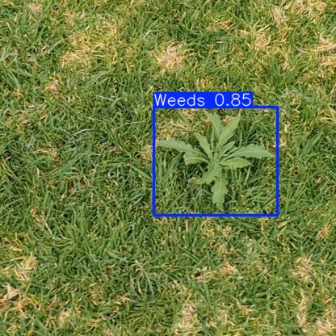
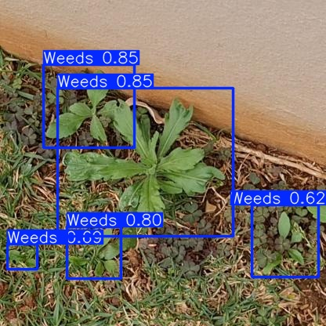
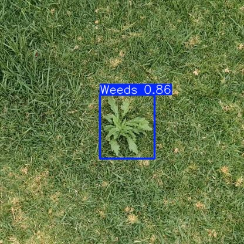

# YOLOv8 Weed Detection in Agricultural Fields

Fine-tuned YOLOv8n for detecting weeds in crop field imagery, trained on the 
[Weeds dataset](https://universe.roboflow.com/augmented-startups/weeds-nxe1w) 
from Roboflow Universe.

## Results

| Metric | Value |
|--------|-------|
| mAP@0.5 | 0.963 |
| F1 Score | 0.93 |
| Precision | 1.00 (at conf 0.942) |
| Recall | 0.99 (at conf 0.000) |
| Epochs | 20 |
| Model | YOLOv8n |

The model was evaluated at a confidence threshold of 0.30, prioritising recall 
over precision — in weed detection, missing a weed (false negative) carries a 
higher cost than flagging a clean patch (false positive), as undetected weeds 
reduce crop yield.

## Example Detections






## Limitations and Next Steps

Trained for 20 epochs on YOLOv8n (the lightest model variant), resulting in a 
~14% miss rate. Switching to YOLOv8s and extending training to 50+ epochs would 
meaningfully reduce false negatives. The current model is suitable as a baseline 
for deployment testing and threshold tuning.

## Setup

```bash
pip install ultralytics roboflow
```

## Run the Notebook

Open `weed_detection.ipynb` and run all cells in order. The notebook covers:
- Dataset download via Roboflow API
- YOLOv8 fine-tuning
- Evaluation and metric plots
- Inference on test images
- ONNX export for deployment

## Export

The trained model is exported to ONNX format for deployment:

```python
model.export(format='onnx', imgsz=640, simplify=True)
```

## Relevance to Agricultural Machinery

Agricultural machines operate under variable, uncontrolled field conditions — 
changing light, soil type, crop density, and weed species distribution. This 
project explores the detection pipeline relevant to precision agriculture 
applications such as selective spraying and automated sorting, where model 
robustness under distribution shift is a central challenge.

## Dataset

- Source: Roboflow Universe — Weeds (augmented-startups/weeds-nxe1w, v3)
- Format: YOLOv8
- Classes: Weeds, Background
